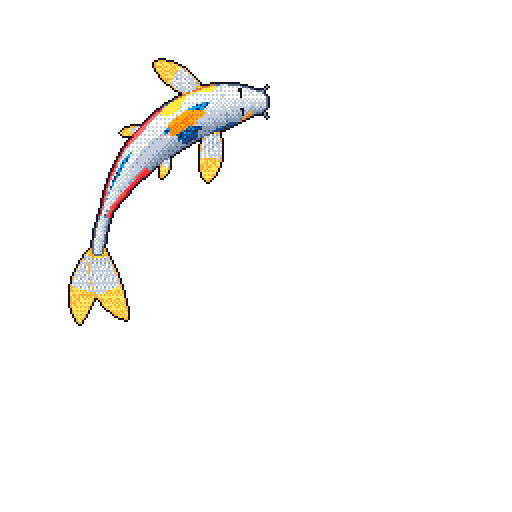

# Laksh Goyal

CS at UC San Diego. I build backend systems, AI infrastructure, and developer tools, focusing on latency, throughput, and reliability.

I like taking systems from idea to deployment, profiling bottlenecks, testing failure cases, and measuring the tradeoffs.

[Website](https://lakshgoyal.com) · [LinkedIn](https://linkedin.com/in/lakshgoyal) · [Email](mailto:lakshgoyal06@gmail.com)

## 2x Founding Engineer

- **Pylon** built a counter-drone sensor mesh and raised **$100K** in the Bow Capital incubator. I led 3 engineers from architecture through operator field tests, building radio capture, anomaly detection, networking, and the operator dashboard. [Code](https://github.com/lgoyal6/pylon) · [Interactive demo](https://lattice-pm4d.vercel.app)

- **Inovasity** built 3D wound imaging and analysis tools. I worked with 12 clinicians across 3 organizations to build the imaging workflow, cutting wound-outlining time **80%** through automated segmentation and asynchronous processing. [Company](https://www.linkedin.com/company/inovasity/)

Currently a **Software Engineer Intern at DR Financial**, building healthcare workflow automation. Previously worked on AI platform systems at **GMI Cloud** and ML systems at **Qualcomm Institute**.

## Shipped projects

- **Leaf** is a native macOS file-search app. Search by name, contents, file type, or date, with matching lines and PDF pages shown in the results. Built with Swift, SwiftUI, and AppKit. [Code](https://github.com/lgoyal6/findr) · [Download](https://github.com/lgoyal6/findr/releases/latest)

- **amac** helps me keep track of multiple coding agents, automations, approvals, and follow-up work from my Mac or phone. [Code](https://github.com/lgoyal6/amac) · [Try locally](https://github.com/lgoyal6/amac#see-it-without-adopting-it)

- **Strata** is a C++ storage engine. Its crash tests check whether acknowledged writes survive process failures. [Code](https://github.com/lgoyal6/strata) · [Demo](https://lgoyal6.github.io/strata/)

- **Winnow** compresses LLM inputs and measures the tradeoffs in useful information retained, token savings, and latency. [Code](https://github.com/lgoyal6/winnow) · [Demo video](https://devpost.com/software/winnow-dzb281)

- **GPU Broker** puts shared cloud and lab GPUs behind one training-job queue, with per-user budgets, checkpointing, and interruption handling. [Code](https://github.com/lgoyal6/gpu-broker) · [Sample dashboard](https://gpu-broker-status.vercel.app)

## 15 hackathon wins

A few highlights from projects built with my teams.

- **Skeptic** is an agent that tests its tools and learns where their documentation is wrong. It won **1st place in 3 tracks** at Hyphenate's Syndicate hackathon. [Project](https://devpost.com/software/skeptic-vczylb)

- **Pylon** won **1st Bow Capital Defense**, joined the **Bow Capital incubator**, and raised **$100K** as a counter-drone startup. [Project](https://devpost.com/software/pylon-3djs6c)

- **Headcount** is an evacuation check-in system that won **3 awards** at UCSD Hack for Humanity, including the Social Good track, Best Use of Gemini API, and Best Use of GitHub Copilot. [Project](https://github.com/lgoyal6/headcount)

## Open source

- **Switch** merged my fix for desktop login failures when the operating system's secure storage is unavailable. [Pull request](https://github.com/sandbox-quantum/switch/pull/1574)

- **Awkward Array** contributions include a proposed JSON serialization fix for unpaired Unicode surrogates. [Repository](https://github.com/scikit-hep/awkward) · [Pull request](https://github.com/scikit-hep/awkward/pull/4408)

## Community and leadership

- **OpenAI Student Collective** Lead at UC San Diego.

- **AWS Student Builder Club** Technical Workshops and Projects Lead at UC San Diego.

- **GMI Cloud Ambassador**, part of the Clouder program. [Program](https://www.gmicloud.ai/en/company/ambassador-program)

- **Adobe Student Ambassador** at UC San Diego.

Mostly working in **Python, C++, Go, TypeScript, and Swift**, with **PyTorch, PostgreSQL, Docker, and AWS**.

  
   
  <a href="https://github.com/lgoyal6?tab=overview">View GitHub activity</a>

